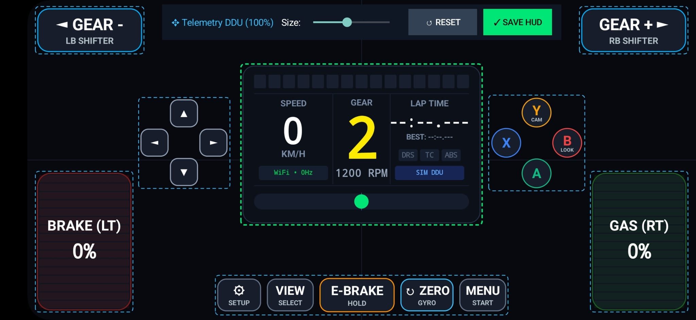
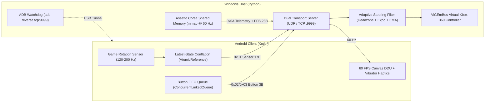

# Phoneel `v0.1-beta`

**Phoneel** is a bidirectional smartphone steering controller and vehicle telemetry display built primarily for **Assetto Corsa** on PC. It streams 120–200 Hz gyroscope steering and analog pedal inputs from Android to a virtual Xbox 360 controller on Windows (`ViGEmBus`), while reading Assetto Corsa shared memory (`acpmf_physics`, `acpmf_graphics`, `acpmf_static`) at 60 Hz to drive a live digital dash unit (DDU) and tire-slip / kerb haptic feedback on the phone.

| Live In-Game Telemetry DDU | Interactive HUD Layout Editor |
| :---: | :---: |
|  |  |


---

## Architecture



### Transport Layer & Conflation

1. **Zero-Queue Sensor Conflation (`Android -> PC`):**
   Hardware rotation events arrive every $5\text{–}8\text{ ms}$ ($120\text{–}200\text{ Hz}$). Instead of pushing sensor packets into an unbounded queue—which introduces queuing delay if the network socket briefly blocks—the sensor thread writes into a single lock-free `AtomicReference<ByteArray?>` slot (`latestSensorPacket.set(...)`), and the dedicated network writer thread atomically consumes it via `getAndSet(null)`. Stale intermediate orientations are overwritten in-place, guaranteeing zero queue accumulation.
2. **Reliable Discrete Events:**
   Button presses (`0x02`), releases (`0x03`), and gyro calibration requests (`0x07`) are routed through a separate `ConcurrentLinkedQueue` drained prior to sensor reads so discrete state transitions are never dropped.
3. **Dual Transport (`UDP` & `TCP`):**
   - **USB Mode:** Uses `adb reverse tcp:9999 tcp:9999` managed by a background watchdog (`pc/adb_manager.py`) with `TCP_NODELAY` and 2-byte little-endian length framing.
   - **Wi-Fi Mode:** Uses connectionless UDP datagrams on port `9999` with subnet + global broadcast discovery on port `9998`.

---

## Mathematical Formulation & Signal Processing

### 1. Coordinate Remapping & Tilt-Invariant Steering Extraction (`SensorReader.kt`)

Phoneel uses Android's hardware-fused `TYPE_GAME_ROTATION_VECTOR` (accelerometer + gyroscope fusion without magnetometer yaw drift). Given the unit quaternion $\mathbf{q} = (x, y, z, w)$ from the sensor hub:

1. Convert $\mathbf{q}$ to a $3 \times 3$ device rotation matrix $\mathbf{R}$ via `SensorManager.getRotationMatrixFromVector`.
2. Remap the coordinate frame for landscape orientation (device rotated $90^\circ$ counter-clockwise, where screen $X = \text{device } Y$ and screen $Y = -\text{device } X$):

$$\mathbf{R}' = \mathrm{remapCoordinateSystem}\left(\mathbf{R}, \mathrm{AXIS\text{-}Y}, \mathrm{AXIS\text{-}MINUS\text{-}X}\right)$$

3. Extract the world-Up unit vector $\mathbf{u} = (u_x, u_y, u_z) = (R'_{20}, R'_{21}, R'_{22})$ in the landscape device frame. Standard Euler roll ($\mathrm{atan2}(-u_x, u_z)$) hits gimbal lock when the phone is held upright like a steering wheel ($\theta \in [60^\circ, 90^\circ]$, where $u_z = \cos\theta \to 0$). Phoneel projects gravity onto the in-screen vertical axis $u_y = \sin\theta\cos\alpha$ when held upright ($\sin\theta$ cancels out in $\mathrm{atan2}(-u_x, u_y)$) and blends continuously into $u_z$ only when laid flat on a desk ($u_z > 0.70$):

$$t = \mathrm{clip}\left(\frac{u_z - 0.70}{0.15}, 0, 1\right), \qquad \phi = \mathrm{atan2}\left(-u_x, \, (1 - t) s_y u_y + t u_z\right)$$

4. Normalize the wrapped steering angle $\Delta\phi = \mathrm{wrap}_{[-\pi, \pi]}(\phi - \phi_0)$ relative to the calibrated center offset $\phi_0$ and configured lock angle $\Phi \in [40^\circ, 100^\circ]$ (default $\Phi = 80^\circ$ at `Sensitivity 4`):

$$u = \mathrm{clip}\left(\frac{\Delta\phi}{\Phi}, -1.0, 1.0\right)$$

---

### 2. Steering Signal Processing Chain (`pc/filters.py`)

Each incoming steering sample $x \in [-1, 1]$ passes through a 4-stage pipeline before being mapped to the 16-bit signed XInput axis ($[-32768, 32767]$):

#### Stage A: Center Deadzone Normalization
Suppresses resting hand tremor within $|x| < d_z$ (default $d_z = 0.005$) and rescales the remaining domain continuously from $0$:

$$x_1 = \begin{cases} 0 & \text{if } |x| < d_z \\ \mathrm{sgn}(x)\frac{|x| - d_z}{1 - d_z} & \text{otherwise} \end{cases}$$

#### Stage B: Non-Linear Exponential Response Curve
Applies an exponential curve $\gamma \in [1.0, 2.2]$ (default $\gamma = 1.30$) to increase angular resolution near the center while preserving $100\%$ steering lock at $|x_1| = 1$:

$$x_2 = \mathrm{sgn}(x_1)|x_1|^{\gamma}$$

#### Stage C: Optional XInput Anti-Deadzone
For titles with an unconfigurable internal gamepad deadzone $d_a$:

$$x_3 = \mathrm{sgn}(x_2)\left(d_a + (1 - d_a)|x_2|\right)$$

#### Stage D: Speed-Sensitive & Counter-Steer Adaptive EMA Filter
A standard fixed-alpha Exponential Moving Average (EMA) either leaves high-speed straight-line jitter unfiltered or introduces phase lag during rapid counter-steering (catching oversteer). Phoneel computes a $C^1$-continuous dynamic smoothing factor $\alpha \in [0.28, 0.92]$ per packet (default base $\alpha_0 = 0.65$, speed damping $d_s = 0.50$) based on vehicle speed $v$ ($\text{km/h}$) and instantaneous steering delta $\Delta = |x_3 - y_{t-1}|$:

$$\alpha_{\mathrm{steady}} = \max\left(0.28, \, \alpha_0 (1 - 0.45 k_v w_c d_s)\right), \qquad \alpha = \alpha_{\mathrm{steady}} + (0.92 - \alpha_{\mathrm{steady}}) \cdot \mathrm{clip}\left(\frac{\Delta - 0.04}{0.22}, 0, 1\right)^2$$

where:
- $k_v = \mathrm{clip}\left(\frac{v - 60}{180}, 0, 1\right)$ scales damping between $60\text{ km/h}$ and $240\text{ km/h}$,
- $w_c = \max(0, 1 - 5.0|x_3|)$ restricts damping strictly to the narrow straight-line corridor ($|x_3| < 0.20$) so fast sweeping corners retain $100\%$ turn-in authority,
- $y_t = \alpha x_3 + (1 - \alpha)y_{t-1}$ is the filtered output.

---

### 3. Progressive Throttle Modulation (`CockpitViews.kt`)

Touch vertical displacement $h \in [0, 1]$ on the throttle pedal is mapped through a power curve ($\gamma_g = 1.45$) so the lower $0\text{–}70\%$ of physical finger travel provides finer torque modulation on corner exit:

$$u_g = \mathrm{clip}\left(\frac{h - 0.06}{0.88}, 0, 1\right)^{1.45}$$

---

### 4. Shared Memory Telemetry & Haptic Synthesis (`pc/ac_telemetry.py`)

The server inspects Windows named file mappings (`Local\acpmf_physics`, `Local\acpmf_graphics`, `Local\acpmf_static`) using Win32 `OpenFileMappingW` prior to opening read-only `mmap` views. This prevents pre-allocating undersized pagefile mappings when the server starts before Assetto Corsa.

When `SPageFileGraphics.status == 2` (`AC_LIVE`), two 8-bit haptic channels ($[0, 255]$) are synthesized at $60\text{ Hz}$:

1. **Tire Slip / Oversteer Channel (`ffb_slip`):**
   Weights rear-axle slip (`wheelSlip[2, 3]`) higher than front-axle slip (`wheelSlip[0, 1]`) so rear traction loss is felt immediately:

$$S = \max\left(1.15 \max(|s_2|, |s_3|), 0.65 \max(|s_0|, |s_1|)\right)$$

$$I_{\mathrm{slip}} = \mathrm{clip}\left(\left\lfloor 255 \cdot \frac{S - 0.85}{2.20} \right\rfloor, 0, 255\right)$$

2. **Kerb & Shift Channel (`ffb_kerb`):**
   Combines frame-to-frame suspension travel derivative $\Delta z_i$ across all four corners with vertical G-force peaks $|G_y|$ and gear-change impulses:

$$I_{\mathrm{kerb}} = \mathrm{clip}\left(\left\lfloor 255 \cdot \left(140 \max_i \Delta z_i + 0.45 \max(0, |G_y| - 1.35)\right) \right\rfloor, 0, 255\right)$$

---

## Binary Protocol Specification

All multi-byte fields are **Little-Endian**.

| Type | Name | Direction | Size | Struct Format & Fields |
| :--- | :--- | :--- | :--- | :--- |
| `0x01` | `SENSOR` | Phone $\to$ PC | 17 B | `<BfffI` — `type`, `steering (-1..1)`, `gas (0..1)`, `brake (0..1)`, `timestamp_ms` |
| `0x02` | `BTN_PRESS` | Phone $\to$ PC | 3 B | `<BH` — `type`, `button_id` |
| `0x03` | `BTN_RELEASE` | Phone $\to$ PC | 3 B | `<BH` — `type`, `button_id` |
| `0x05` | `DISC_PING` | Phone $\to$ PC | 5 B | `<BI` — `type`, `port` |
| `0x06` | `DISC_PONG` | PC $\to$ Phone | Var | `0x06` + UTF-8 `hostname` |
| `0x07` | `CALIBRATE` | Phone $\to$ PC | 1 B | `<B` — Re-center roll offset & reset filter state |
| `0x09` | `HEARTBEAT` | Phone $\to$ PC | 5 B | `<BI` — `type`, `timestamp_ms` |
| `0x0A` | `TELEMETRY` | PC $\to$ Phone | 23 B | `<BfHHbBIIHBB` — `type`, `speed_kmh`, `rpm`, `max_rpm`, `gear`, `flags`, `lap_ms`, `best_ms`, `pos`, `ffb_slip`, `ffb_kerb` |

---

## Setup & Usage

### 1. PC Requirements
1. Install the **[ViGEmBus Driver](https://github.com/nefarius/ViGEmBus/releases)**.
2. Double-click **`Phoneel.exe`** (standalone portable executable; no Python installation required).
   - *For running from source:* `pip install -r pc/requirements.txt` and `python pc/main.py`.
   - If an Android device with USB Debugging enabled is connected via USB, the server automatically configures `adb reverse tcp:9999 tcp:9999`.

### 2. Android Client
Install **`Phoneel-v0.1-beta.apk`** directly on your phone, or build from source:
```bash
cd android
./gradlew assembleDebug
adb install -r app/build/outputs/apk/debug/app-debug.apk
```

### 3. Assetto Corsa / Content Manager Controller Settings
Phoneel is calibrated specifically around Assetto Corsa's physics and shared memory pipeline. Because deadzone normalization ($d_z = 0.005$), exponential response ($\gamma = 1.30$), and speed-sensitive damping ($d_s = 0.50$) are already processed on the PC host, Assetto Corsa's built-in thumbstick filters must be set as follows so they do not stack or add steering lag:

- **Input Method:** `Gamepad` (`Xbox 360`)
- **Speed Sensitivity:** `10%`
- **Steering Speed:** `100%`
- **Steering Gamma:** `100%`
- **Steering Filter:** `0%`
- **Steering Deadzone:** `1%`
- **Rumble Effects:** `0%` *(Haptics are driven directly from AC Shared Memory at 60 Hz)*
- **Custom Shaders Patch (CSP) $\to$ Gamepad FX:** **Disabled (`Off`)** — *Gamepad FX is designed for physical thumbsticks and overrides direct steering angles with counter-steer assist scripts.*

---

## Project Structure

```text
phoneel/
├── Phoneel.exe                  # Standalone portable Windows executable
├── Phoneel-v0.1-beta.apk        # Pre-built Android client APK
├── LICENSE                      # MIT License
├── pc/
│   ├── main.py                  # Server entry point, 60 Hz telemetry loop, input routing
│   ├── receiver.py              # Dual UDP/TCP server & LAN discovery responder
│   ├── protocol.py              # Binary packet serialization (<BfffI, <BfHHbBIIHBB)
│   ├── filters.py               # Deadzone, exponential curve, and adaptive EMA filter
│   ├── ac_telemetry.py          # Assetto Corsa shared memory reader & FFB synthesizer
│   ├── gamepad.py               # ViGEmBus virtual Xbox 360 controller wrapper
│   ├── adb_manager.py           # Automatic USB ADB reverse port-forwarding daemon
│   ├── dashboard.py             # Tkinter real-time input, telemetry, and filter UI
│   └── build_exe.py             # PyInstaller single-file portable build script
└── android/app/src/main/java/com/phoneel/
    ├── MainActivity.kt          # Cockpit UI, Haptic FFB driver, drag-and-drop HUD editor
    ├── CockpitViews.kt          # Custom 60 FPS Canvas views (DDU, Xbox buttons, analog pedals)
    ├── SensorReader.kt          # Tilt-invariant rotation matrix to steering pipeline
    ├── UdpSender.kt             # Lock-free conflated transmitter & telemetry receiver
    ├── Protocol.kt              # Binary packet builders and parsers
    └── Discovery.kt             # Subnet & global UDP broadcast scanner
```

---

## Changelog (`v0.1-beta` Update)

- **Upright Steering Gimbal-Lock Fix (`SensorReader.kt`):** Replaced `SensorManager.getOrientation()` Euler roll (`atan2(-u_x, u_z)`) with in-screen gravity projection (`atan2(-u_x, u_y)`). Holding the phone upright at $60^\circ\text{–}90^\circ$ no longer causes sensitivity spikes near $u_z \to 0$, and the full `Sensitivity 1–10` ($\pm 100^\circ \dots \pm 40^\circ$) range now maps 1:1.
- **Filter Tuning & Continuous Counter-Steer Blend (`pc/filters.py`, `pc/dashboard.py`):**
  - Updated default filter parameters for linear AC settings (`EMA Alpha = 0.65`, `Expo = 1.30`, `High-Speed Damping = 0.50`, `Deadzone = 0.005`) and added a live `High-Speed Damping` slider to the desktop UI.
  - Restricted high-speed damping to the narrow straight-line center ($|x| < 0.20$) so fast corners keep full turn-in response.
  - Replaced the step threshold at $\Delta > 0.10$ with a $C^1$-continuous quadratic blend to eliminate steering snaps during Wi-Fi jitter.
- **Wi-Fi Low-Latency Lock & Event-Driven TX (`UdpSender.kt`, `MainActivity.kt`):** Replaced `Thread.sleep(1)` polling with `LockSupport.unpark` wakeup, added Android `WIFI_MODE_FULL_LOW_LATENCY` lock, and set UDP `IPTOS_LOWDELAY` (`0x10`) traffic class to prevent 60 Hz timer-slack drops.
- **AC Pause State & DDU Badge (`pc/ac_telemetry.py`, `CockpitViews.kt`):** Fixed `AC LIVE` $\leftrightarrow$ `SYNTHETIC` oscillation when paused in the Assetto Corsa `ESC` menu (`gfx.status == 3`) and unified the standby badge label as `SYNTHETIC`.
