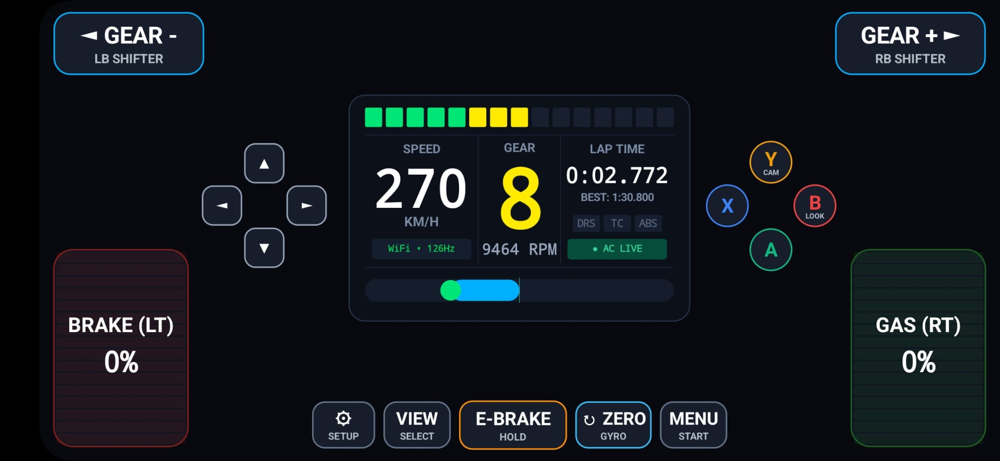
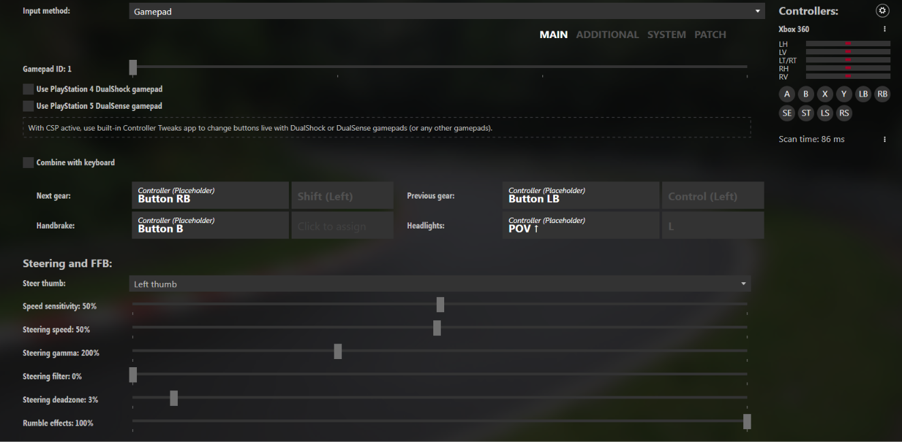
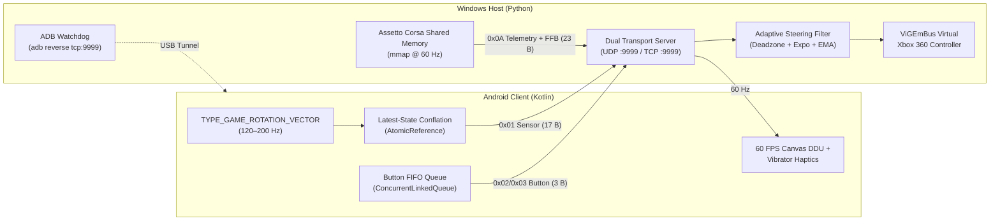

# Phoneel `v0.1-beta`

**Phoneel** is a bidirectional smartphone steering controller and vehicle telemetry display for PC racing simulations. It streams high-frequency orientation and analog pedal inputs from Android to a virtual Xbox 360 controller on Windows (`ViGEmBus`), while simultaneously reading telemetry from Assetto Corsa shared memory at 60 Hz to drive a real-time digital dash unit (DDU) and haptic feedback engine on the phone.

| Live In-Game Telemetry DDU | Interactive HUD Layout Editor |
| :---: | :---: |
|  |  |



---

## Architecture



### Transport Layer & Conflation

1. **Zero-Queue Sensor Conflation (`Android -> PC`):**
   Hardware rotation events arrive every $5\text{–}8\text{ ms}$ ($120\text{–}200\text{ Hz}$). Instead of pushing sensor packets into an unbounded queue—which introduces queuing delay if the network socket briefly blocks—the sensor thread writes into a single lock-free `AtomicReference<ByteArray?>` slot (`latestSensorPacket.set(...)`), and the dedicated network writer thread atomically consumes it via `getAndSet(null)`. Stale intermediate orientations are overwritten in-place, guaranteeing zero queue accumulation.
2. **Reliable Discrete Events:**
   Button presses (`0x02`), releases (`0x03`), and gyro calibration requests (`0x07`) are routed through a separate `ConcurrentLinkedQueue` drained prior to sensor reads so discrete state transitions are never dropped.
3. **Dual Transport (`UDP` & `TCP`):**
   - **USB Mode:** Uses `adb reverse tcp:9999 tcp:9999` managed by a background watchdog (`pc/adb_manager.py`) with `TCP_NODELAY` and 2-byte little-endian length framing.
   - **Wi-Fi Mode:** Uses connectionless UDP datagrams on port `9999` with subnet + global broadcast discovery on port `9998`.

---

## Mathematical Formulation & Signal Processing

### 1. Coordinate Remapping & Roll Extraction (`SensorReader.kt`)

Phoneel uses Android's hardware-fused `TYPE_GAME_ROTATION_VECTOR` (accelerometer + gyroscope fusion without magnetometer yaw drift). Given the unit quaternion $\mathbf{q} = (q_x, q_y, q_z, q_w)$ from the sensor hub:

1. Convert $\mathbf{q}$ to a $3 \times 3$ device rotation matrix $\mathbf{R}_{\text{dev}}$ via `SensorManager.getRotationMatrixFromVector`.
2. Remap the coordinate frame for landscape orientation (device rotated $90^\circ$ counter-clockwise, where screen $X = \text{device } Y$ and screen $Y = -\text{device } X$):
   $$\mathbf{R}_{\text{land}} = \text{remapCoordinateSystem}(\mathbf{R}_{\text{dev}}, \text{AXIS\_Y}, \text{AXIS\_MINUS\_X})$$
3. Extract Euler angles $(\psi, \theta, \phi)$ from $\mathbf{R}_{\text{land}}$ and normalize the roll angle $\phi$ relative to the calibrated center offset $\phi_0$ and configured lock angle $\phi_{\max} \in [40^\circ, 100^\circ]$:
   $$u_{\text{raw}} = \text{clip}\!\left(\frac{\phi - \phi_0}{\phi_{\max}},\, -1.0,\, 1.0\right)$$

---

### 2. Steering Signal Processing Chain (`pc/filters.py`)

Each incoming steering sample $x \in [-1, 1]$ passes through a 4-stage pipeline before being mapped to the 16-bit signed XInput axis ($[-32768, 32767]$):

#### Stage A: Center Deadzone Normalization
Suppresses resting hand tremor within $|x| < d_z$ (default $d_z = 0.005$) and rescales the remaining domain continuously from $0$:
$$x_1 = \begin{cases} 0 & \text{if } |x| < d_z \\ \text{sgn}(x)\,\dfrac{|x| - d_z}{1 - d_z} & \text{otherwise} \end{cases}$$

#### Stage B: Non-Linear Exponential Response Curve
Applies an exponential curve $\gamma \in [1.0, 2.2]$ (default $\gamma = 1.35$) to increase angular resolution near the center while preserving $100\%$ steering lock at $|x_1| = 1$:
$$x_2 = \text{sgn}(x_1)\,|x_1|^{\gamma}$$

#### Stage C: Optional XInput Anti-Deadzone
For titles with an unconfigurable internal gamepad deadzone $d_{\text{anti}}$:
$$x_3 = \text{sgn}(x_2)\,\left(d_{\text{anti}} + (1 - d_{\text{anti}})|x_2|\right)$$

#### Stage D: Speed-Sensitive & Counter-Steer Adaptive EMA Filter
A standard fixed-alpha Exponential Moving Average (EMA) either leaves high-speed straight-line jitter unfiltered or introduces phase lag during rapid counter-steering (catching oversteer). Phoneel computes a dynamic smoothing factor $\alpha_{\text{eff}} \in [0.22, 0.96]$ per packet based on vehicle speed $v$ ($\text{km/h}$) and instantaneous steering delta $\Delta = |x_3 - y_{t-1}|$:

$$\alpha_{\text{eff}} = \begin{cases} \min\!\big(0.96,\; \alpha_0 + 1.8(\Delta - 0.10)\big) & \text{if } \Delta > 0.10 \quad \text{(rapid counter-steer)} \\[6pt] \max\!\big(0.22,\; \alpha_0 (1 - 0.45\,k_{\text{spd}}\,w_{\text{ctr}}\,d_{\text{spd}})\big) & \text{if } \Delta \le 0.10 \quad \text{(steady-state)} \end{cases}$$

where:
- $k_{\text{spd}} = \text{clip}\!\left(\dfrac{v - 60}{180},\, 0,\, 1\right)$ scales damping between $60\text{ km/h}$ and $240\text{ km/h}$,
- $w_{\text{ctr}} = \max(0,\, 1 - 1.6|x_3|)$ restricts damping to the center region,
- $y_t = \alpha_{\text{eff}}\,x_3 + (1 - \alpha_{\text{eff}})\,y_{t-1}$ is the filtered output.

---

### 3. Progressive Throttle Modulation (`CockpitViews.kt`)

Touch vertical displacement $h \in [0, 1]$ on the throttle pedal is mapped through a power curve ($\gamma_{\text{gas}} = 1.45$) so the lower $0\text{–}70\%$ of physical finger travel provides finer torque modulation on corner exit:
$$u_{\text{gas}} = \text{clip}\!\left(\frac{h - 0.06}{0.88},\, 0,\, 1\right)^{\!1.45}$$

---

### 4. Shared Memory Telemetry & Haptic Synthesis (`pc/ac_telemetry.py`)

The server inspects Windows named file mappings (`Local\acpmf_physics`, `Local\acpmf_graphics`, `Local\acpmf_static`) using Win32 `OpenFileMappingW` prior to opening read-only `mmap` views. This prevents pre-allocating undersized pagefile mappings when the server starts before Assetto Corsa.

When `SPageFileGraphics.status == 2` (`AC_LIVE`), two 8-bit haptic channels ($[0, 255]$) are synthesized at $60\text{ Hz}$:

1. **Tire Slip / Oversteer Channel (`ffb_slip`):**
   Weights rear-axle slip ($\text{wheelSlip}[2, 3]$) higher than front-axle slip ($\text{wheelSlip}[0, 1]$) so rear traction loss is felt immediately:
   $$s_{\text{comb}} = \max\!\big(1.15 \max(|s_{\text{RL}}|, |s_{\text{RR}}|),\; 0.65 \max(|s_{\text{FL}}|, |s_{\text{FR}}|)\big)$$
   $$\text{ffb\_slip} = \text{clip}\!\left(\left\lfloor 255 \cdot \frac{s_{\text{comb}} - 0.85}{2.20} \right\rfloor,\, 0,\, 255\right)$$

2. **Kerb & Shift Channel (`ffb_kerb`):**
   Combines frame-to-frame suspension travel derivative $\Delta z_i = |z_{i,t} - z_{i,t-1}|$ across all four corners with vertical G-force peaks $|G_y|$ and gear-change impulses:
   $$\text{ffb\_kerb} = \text{clip}\!\left(\left\lfloor 255 \cdot \big(140 \max_i \Delta z_i + 0.45 \max(0, |G_y| - 1.35)\big) \right\rfloor,\, 0,\, 255\right)$$

---

## Binary Protocol Specification

All multi-byte fields are **Little-Endian**.

| Type | Name | Direction | Size | Struct Format & Fields |
| :--- | :--- | :--- | :--- | :--- |
| `0x01` | `SENSOR` | Phone $\to$ PC | 17 B | `<BfffI` — `type`, `steering (-1..1)`, `gas (0..1)`, `brake (0..1)`, `timestamp_ms` |
| `0x02` | `BTN_PRESS` | Phone $\to$ PC | 3 B | `<BH` — `type`, `button_id` |
| `0x03` | `BTN_RELEASE` | Phone $\to$ PC | 3 B | `<BH` — `type`, `button_id` |
| `0x05` | `DISC_PING` | Phone $\to$ PC | 5 B | `<BI` — `type`, `port` |
| `0x06` | `DISC_PONG` | PC $\to$ Phone | Var | `0x06` + UTF-8 `hostname` |
| `0x07` | `CALIBRATE` | Phone $\to$ PC | 1 B | `<B` — Re-center roll offset & reset filter state |
| `0x09` | `HEARTBEAT` | Phone $\to$ PC | 5 B | `<BI` — `type`, `timestamp_ms` |
| `0x0A` | `TELEMETRY` | PC $\to$ Phone | 23 B | `<BfHHbBIIHBB` — `type`, `speed_kmh`, `rpm`, `max_rpm`, `gear`, `flags`, `lap_ms`, `best_ms`, `pos`, `ffb_slip`, `ffb_kerb` |

---

## Setup & Usage

### 1. PC Requirements
1. Install the **[ViGEmBus Driver](https://github.com/nefarius/ViGEmBus/releases)**.
2. Install Python dependencies:
   ```bash
   pip install -r pc/requirements.txt
   ```

### 2. Running the Server
Double-click **`Phoneel.exe`** in the repository root (or run `python pc/main.py`).
- If an Android device with USB Debugging enabled is connected via USB, the server automatically configures `adb reverse tcp:9999 tcp:9999`.

### 3. Building the Android Client
```bash
cd android
./gradlew assembleDebug
adb install -r app/build/outputs/apk/debug/app-debug.apk
```

---

## Project Structure

```text
phoneel/
├── Phoneel.exe                  # Windows native GUI launcher (no console window)
├── pc/
│   ├── main.py                  # Server entry point, 60 Hz telemetry loop, input routing
│   ├── receiver.py              # Dual UDP/TCP server & LAN discovery responder
│   ├── protocol.py              # Binary packet serialization (<BfffI, <BfHHbBIIHBB)
│   ├── filters.py               # Deadzone, exponential curve, and adaptive EMA filter
│   ├── ac_telemetry.py          # Assetto Corsa shared memory reader & FFB synthesizer
│   ├── gamepad.py               # ViGEmBus virtual Xbox 360 controller wrapper
│   ├── adb_manager.py           # Automatic USB ADB reverse port-forwarding daemon
│   └── dashboard.py             # Tkinter real-time input, telemetry, and filter UI
└── android/app/src/main/java/com/phoneel/
    ├── MainActivity.kt          # Cockpit UI, Haptic FFB driver, drag-and-drop HUD editor
    ├── CockpitViews.kt          # Custom 60 FPS Canvas views (DDU, Xbox buttons, analog pedals)
    ├── SensorReader.kt          # Game Rotation Vector quaternion-to-roll pipeline
    ├── UdpSender.kt             # Lock-free conflated transmitter & telemetry receiver
    ├── Protocol.kt              # Binary packet builders and parsers
    └── Discovery.kt             # Subnet & global UDP broadcast scanner
```

---

## Status & Development Note

- **Current Release:** `v0.1-beta`
- **Development:** Engineered iteratively using AI-assisted workflows alongside live closed-loop telemetry and latency profiling in Assetto Corsa.
